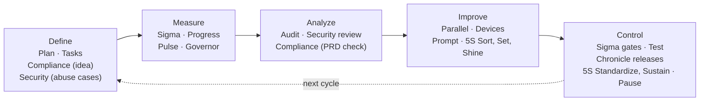
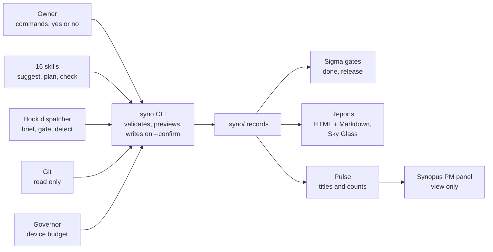

# PRD — Syno

PRD 0.2 · 2026-10-30 · Owner: Synopus · Status: Draft
Live, editable copy: https://claude.ai/artifact/1jALqwFo1TFHLrwAKMmZNi

> **What changed in 0.2 (2026-10-30).** Syno is no longer only a version controller. It is one Claude Code plugin from Synopus that holds 16 functions, all named "Syno ___". The version controller from PRD 0.1 is now **Syno Chronicle** (section 6.1), with its 14 features kept. Synopus Insider becomes **Syno Pulse**, and the panel's approval step is removed. Six Sigma and 5S now shape every function. Sections marked *(new in 0.2)* or *(changed in 0.2)* differ from PRD 0.1.

## At a glance *(new in 0.2)*

**Verdict:** one install gives every Synopus project tool, measured for quality the same way and reported in plain English.

- Syno is a free, MIT-licensed Claude Code plugin by Synopus, installed once per machine from GitHub.
- It merges 10 tools Synopus already uses, renamed "Syno ___", and adds 6 new functions.
- Six Sigma (Define, Measure, Analyze, Improve, Control) and 5S (Sort, Set in Order, Shine, Standardize, Sustain) apply to every function.
- Compliance and Security are checked from the first idea, not after the build.
- Syno Pulse lets the Synopus PM panel watch every project. The panel can watch, never control.

| Function | What it does for you | Command | Built from |
| --- | --- | --- | --- |
| Syno Chronicle | Keeps a readable record of ideas, changes, releases and where they shipped | `/syno:init`, `/syno:release` … | PRD 0.1 (version controller) |
| Syno Pulse | Sends titles and counts to the Synopus PM panel | `/syno:pulse` | Synopus Insider 0.1.1 |
| Syno Progress | Shows how far the project has come, phase by phase | `/syno:progress` | project-progress-report |
| Syno Tasks | Breaks the work into tasks and tracks each one to done | `/syno:tasks` | task-breakdown-progress-report |
| Syno Audit | Finds bugs and errors without changing code | `/syno:audit` | codebase-audit |
| Syno Devices | Keeps desktop and mobile apps matched to the web app | `/syno:devices` | akmo-app-sync 0.1.0 |
| Syno Test | Writes a test guide anyone can follow, with Pass and Fail buttons | `/syno:test` | easy-test-guide |
| Syno Parallel | Finishes the remaining work with several agents at once | `/syno:parallel` | parallel-finish |
| Syno Plan | Brainstorms an idea and writes the PRD | `/syno:plan` | prd-brainstorm |
| Syno Prompt | Writes better prompts for AI tools | `/syno:prompt` | prompt-master (MIT, Nidhin Joseph Nelson) |
| Syno Governor | Keeps heavy work within what this computer can handle | `/syno:governor` | workload-governor 0.2.0 |
| Syno Pause | Saves where a session stopped, and picks it up later | `/syno:pause`, `/syno:resume` | New |
| Syno Sigma | Measures quality and stops work that isn't ready | `/syno:sigma` | New |
| Syno 5S | Keeps the project's files sorted, clean and consistent | `/syno:5s` | New |
| Syno Compliance | Checks the idea and PRD against the laws that apply | `/syno:compliance` | New |
| Syno Security | Designs out misuse and checks the code for weaknesses | `/syno:security` | New |

## 1. Overview *(changed in 0.2)*

**Problem.** Synopus builds many client projects with Claude Code, on several machines. Its tools are separate installs with different names and different-looking outputs. Quality is not measured the same way in every project. Laws and security are checked late, if at all. Clients and the PM can't read most reports without a developer explaining them.

**Goals**

- One install gives every Synopus function, under one command prefix: `/syno:`.
- Every function follows DMAIC and 5S, and quality is measured the same way in every project.
- Every report opens with a verdict that a non-technical person understands in one read.
- Laws and security are checked from the first idea, and again as the work changes.
- The PM panel sees each project's full state through Syno Pulse, and cannot control anything.
- Nothing leaves a machine except Pulse's titles and counts, and only after the person consents.

**Non-goals**

- Not a version-control system. Git stays the source of code history; Syno reads it and never rewrites it.
- No unattended publishing. Syno never pushes, publishes or releases on its own. Syno Devices runs a push or a release workflow only after a yes for that exact action.
- Not legal advice. Syno Compliance flags laws and cites them; a qualified professional confirms Critical items.
- Not a penetration-testing service. Attack tests run against local development hosts only.
- The panel never sends instructions, replies or commands into a session.

## 2. Users and roles *(changed in 0.2)*

There are no Syno accounts. The owner is whoever runs Claude Code in the project and answers its questions.

| Role | Who | Needs | Can do |
| --- | --- | --- | --- |
| Owner | Synopus lead, solo builder, agency lead | Tools that keep quality high without extra process | Approve every write, gate override, file move, build and push |
| Contributor | Teammate on a branch | Record work without merge conflicts | Add ideas, changes and tasks; join Pulse on their own machine |
| Agent | Claude, through Syno's skills | Know when and how to use each function | Suggest, read and dry-run; write only after the owner says yes |
| PM | Synopus project manager | See every project's status, quality and effort in one place | View the panel; revoke a device, correct progress and phase, close blockers, issue cloud keys. Never sends anything to a session |
| Reader | Client, non-technical owner | Understand status without help | Read the reports and docs in a browser or on GitHub |
| CI | GitHub Actions, using the example workflow | Catch a broken record or a failed gate | Run `syno validate`, `syno render --check` and `syno sigma gate --release`; read-only |

## 3. Scope *(changed in 0.2)*

v0.1.0 ships all 16 functions, including all 14 Chronicle features from PRD 0.1, plus four cross-cutting parts. Later phases are in section 17.

| ID | Function or part | Priority | Goes online |
| --- | --- | --- | --- |
| S-01 | Syno Chronicle (features CH-01 to CH-14) | Must | No |
| S-02 | Syno Pulse | Must | Yes, the only one |
| S-03 | Syno Progress | Must | No |
| S-04 | Syno Tasks | Must | No |
| S-05 | Syno Audit | Must | No |
| S-06 | Syno Devices | Must | Only builds the owner approves |
| S-07 | Syno Test | Must | Publishes its checklist page through Claude |
| S-08 | Syno Parallel | Must | No |
| S-09 | Syno Plan | Must | Writes the Claude Doc through Claude |
| S-10 | Syno Prompt | Should | No |
| S-11 | Syno Governor | Must | No |
| S-12 | Syno Pause | Must | No |
| S-13 | Syno Sigma | Must | No |
| S-14 | Syno 5S | Must | No |
| S-15 | Syno Compliance | Must | Claude's web search reads official sources |
| S-16 | Syno Security | Must | No; attack tests reach local hosts only |
| X-01 | Shared report look and language | Must | No |
| X-02 | One hook dispatcher for every function | Must | No |
| X-03 | Migration from the standalone plugins and skills | Must | No |
| X-04 | Syno CLI, records and `/syno:status` | Must | No |

"Goes online" means Syno's own code. Claude's own tools (web search, Claude Docs, artifact pages) are used where a function says so; they are not Syno code and need no network module in Syno.

## 4. How quality works: Six Sigma and 5S *(new in 0.2)*

Six Sigma keeps project management measured and controlled. 5S keeps the project and its files in order. Both are built into every function, not bolted on.

### 4.1 DMAIC: which function does which step



Every function's skill names its DMAIC step at the top, and ends with the Control step: record the result in `.syno/`, feed it to Sigma, render the report, and send it to Pulse when Pulse is on.

### 4.2 Measurements

| Term | Meaning in a Syno project |
| --- | --- |
| Unit | One task in Syno Tasks. Without a task breakdown, one Chronicle change. |
| Opportunity | One check a unit must pass: each acceptance criterion, its test runs, and the audit, security and compliance checks that cover it. |
| Defect | A check that fails: an acceptance criterion failing its first check, a failed test run, a Fail answer in a test guide, a Critical or Major audit finding, a Critical or High security finding, a Critical or Major compliance gap, or a task reopened after done. |
| First-pass yield (FPY) | Units that passed every check the first time, divided by units checked. |
| Sigma level | Short-term sigma from DPMO, using the usual 1.5σ shift. |

```latex
\text{DPMO} = \frac{\text{defects}}{\text{units} \times \text{opportunities per unit}} \times 1{,}000{,}000
```

| Sigma level | DPMO at or below |
| --- | --- |
| 6σ | 3.4 |
| 5σ | 233 |
| 4σ (target) | 6,210 |
| 3σ | 66,807 |
| 2σ | 308,538 |

The Sigma report also shows a Pareto chart of defects by source and a weekly control chart of defects per unit, with points outside the control limit flagged.

### 4.3 Gates

A gate stops work from counting as done, or a release from being cut. The owner can override any gate with a recorded reason.

| Gate | Stops | Passes when |
| --- | --- | --- |
| Done gate | A task being marked done (Tasks, Parallel) | All its acceptance criteria pass, its tests are green, no Critical audit finding is open, and no Critical or High security finding is open |
| Release gate | A Chronicle release being cut | Every done-gate rule, plus no Critical compliance gap open and a compliance check newer than the last PRD change |
| Reported, never blocking | Nothing | Sigma level against the 4σ target, and first-pass yield |

**Override.** Syno asks with AskUserQuestion, and the owner types a reason of at least 10 characters. Syno stores who, when, which gate, which items and why. Every override appears in the Sigma report, in the next release's record, and on the panel through Pulse.

### 4.4 5S

| S | In a project, it means | Syno checks | Syno proposes |
| --- | --- | --- | --- |
| Sort | Keep only what is needed | Unused files, duplicate files, temp and log files, empty folders, large binaries, merged or stale branches | Moving what isn't needed to the restorable trash |
| Set in Order | A place for everything | The folder layout against the project's standards | Moves, with the import changes each move needs |
| Shine | Clean and working | Lint, format and type errors, using the project's own tools | Running the project's formatter and fixer |
| Standardize | One way of doing things | Naming, folder rules, file size limits, required files | A standards file that every Syno function then follows |
| Sustain | Keep it that way | Score per S, trend over time | A reminder when the last 5S check is more than 7 days old |

## 5. Rules every function follows *(new in 0.2)*

### 5.1 The owner decides

Syno proposes and the owner decides. Every write, move, build, push, gate override and Pulse join waits for a yes through AskUserQuestion or Claude Code's own permission prompt. Answering No, or closing the question, changes nothing. Every CLI write needs `--confirm`; without it, a write prints its plan and exits 0.

### 5.2 The network rule

- Only Syno Pulse's network module (`scripts/lib/pulse/net.js`) may open a connection. A self-test fails if any other file in `scripts/` imports `http`, `https`, `net`, `dgram` or `tls`.
- Only the git module and the run module (`scripts/lib/git.js`, `scripts/lib/run.js`) may start processes, each from an allowlist.
- Ported Python scripts (Devices, Test) keep their current behaviour and are listed in `THIRD_PARTY_NOTICES.md` and the self-test's allowlist by file name.

### 5.3 Report look and language (X-01)

Every report a person reads follows one structure, one look and one language standard.

**Structure, in this order**

1. **Verdict:** one line with a label of Green, Amber or Red, and what it means ("Amber: on track, but 2 tasks are overdue").
2. **Summary:** 3 to 5 plain-English bullets.
3. **What you need to do:** the actions only the owner can take, each with who and by when, or "Nothing right now."
4. **Detail:** tables and charts, with a fixed column order per report.
5. **Glossary:** every technical word used above, in one line each.

**Language**

- Plain words, sentences under 25 words. The summary reads at about a 12-year-old's level (Flesch-Kincaid grade 8 or lower), checked by the self-test.
- No jargon without a glossary entry. Statuses are words ("Done", "Overdue"), never a colour or emoji alone.
- Dates in report text read "29 Oct 2026". Records, file names and CHANGELOG.md keep YYYY-MM-DD.

**Look**

- Synopus Sky Glass: the palette, type and spacing used on synopus.in and its emails, dark and light.
- Each report is a styled HTML page with charts that opens in any browser, plus a Markdown copy that reads well on GitHub.
- Everything is embedded: no remote fonts, scripts or images, so pages work offline and leak nothing.
- WCAG 2.2 AA contrast in both themes. Charts always have a table or text with the same facts. Pages print cleanly on A4.

**Where reports go**

| Report | HTML and Markdown saved to | Committed to git |
| --- | --- | --- |
| Chronicle docs | `docs/syno/` (Markdown) and `docs/syno/html/` | Yes |
| Progress, Tasks, Audit, Sigma, 5S, Compliance, Devices | `.syno/reports/<function>/<YYYY-MM-DD>.{html,md}` and `latest.{html,md}` | No, git-ignored |
| Security | `.syno/reports/security/` | No, never by default: it maps weaknesses |
| Plan | `PRD.md` in the project root, plus a Claude Doc | Yes |
| Test | An interactive checklist page published through Claude | Not a file |

### 5.4 What each function sends to Pulse

Pulse sends only when the project is enabled and the machine has joined (S-02). Every event holds titles and counts only: titles up to 120 characters, at most 20 titles per list, redacted for anything that looks like a secret. Code, diffs, file contents, file paths, prompts and Claude's replies are never sent.

| Event | Sent when | Holds |
| --- | --- | --- |
| `chronicle.idea` | An idea is added or changes status | ID, title, status |
| `chronicle.change` | A change is recorded | Type, summary, breaking flag |
| `chronicle.release` | A release is cut or yanked | Version, date, status, change counts by type, ideas shipped, overrides used |
| `chronicle.publish` | A publish is recorded | Version, channel, status, date |
| `progress.snapshot` | Progress runs | Overall %, each phase's name and %, counts of completed, in progress and yet to start, owner-action titles |
| `tasks.snapshot` | Tasks runs, or a task changes status | Counts by status, % done, critical-path length in days, forecast and target dates, overdue and blocked task titles, ready-to-start count |
| `audit.result` | An audit finishes | Counts by category and severity, Critical and Major finding titles |
| `devices.parity` | Devices checks or updates the apps | Per platform: name, app version, web version, In sync / Behind / Not set up |
| `test.result` | A test guide is answered | Scenario titles with Pass or Fail, totals |
| `sigma.snapshot` | Sigma runs or a gate is checked | Units, opportunities, defects, DPMO, sigma level, FPY, gate status |
| `gate.override` | An override is recorded | Gate, item titles, reason, git name |
| `compliance.result` | A compliance check finishes | Jurisdictions, counts by status and severity, gap titles, stale flag |
| `security.result` | A security review finishes | Counts by severity, Critical and High titles, abuse cases planned / enforced / tested / failing |
| `fives.score` | 5S runs | Score per S and overall, 0 to 100 |
| `daily.rollup` | Once a day per project | The latest of each event above, plus active time |

Pulse keeps sending its existing events too: session start and end, activity, commits, test and build runs, milestones, progress updates and blockers.

## 6. Functions and requirements

Each function lists what it does, numbered requirements and acceptance criteria (AC). Functions built from an existing skill or plugin keep that skill's behaviour as their base. The source `SKILL.md` is part of this spec, and only the changes are listed here.

### 6.1 S-01 Syno Chronicle *(was all of PRD 0.1)*

Chronicle keeps a living record of a codebase: its ideas, changes, releases, where each release was published, and how its folders changed. Features CH-01 to CH-14 were F-01 to F-14 in PRD 0.1; their text is unchanged except where marked.

| ID | Feature | Priority |
| --- | --- | --- |
| CH-01 | Set up a new repository | Must |
| CH-02 | Adopt an existing repository | Must |
| CH-03 | Ideas | Must |
| CH-04 | Changes | Must |
| CH-05 | Releases *(changed: release gate)* | Must |
| CH-06 | Publishes | Must |
| CH-07 | Structure snapshots and diffs | Must |
| CH-08 | Timeline | Must |
| CH-09 | Generated docs and CHANGELOG *(changed: report look)* | Must |
| CH-10 | Release notes | Should |
| CH-11 | Sync with tags made outside Syno | Must |
| CH-12 | Session brief and nudges *(changed: one Syno brief)* | Should |
| CH-13 | Validate, render check and CI example *(changed: gate check)* | Must |
| CH-14 | Capture skill | Must |

#### CH-01 Set up a new repository (Must)

`/syno:init` checks whether the codebase is new or existing. A codebase is existing if it has any git commit or a CHANGELOG.md. Existing codebases go to adoption (CH-02).

1. Write `.syno/config.json`, a baseline snapshot, an empty CHANGELOG.md and the five pages in `docs/syno/`.
2. Take the starting version from the first manifest found (section 8). With no manifest, propose 0.1.0 as the first release. The owner confirms.
3. *(new in 0.2)* Propose the `.gitignore` lines for `.syno/sessions/`, `.syno/trash/`, `.syno/reports/` and `.syno/local/`, and write them after a yes.
4. *(new in 0.2)* Ask, as a separate question, whether to enable Syno Pulse for this project.

- AC-CH-01.1: Given an empty folder, when the owner runs `/syno:init` and approves, then the config, baseline snapshot, CHANGELOG.md and five pages exist, and `syno validate` passes.
- AC-CH-01.2: Running init a second time changes no files.
- AC-CH-01.3: Answering No to the `.gitignore` question leaves `.gitignore` unchanged, and `/syno:status` warns that local folders are not ignored.

#### CH-02 Adopt an existing repository (Must)

Adoption reads history and never changes it.

1. Read git tags that match the tag pattern (default `v?MAJOR.MINOR.PATCH[-pre]`), with their dates and commits. By default read the last 50 tags; `--all` reads every tag.
2. Classify commits between tags by Conventional Commits prefix:
    - `feat` → Added
    - `fix` → Fixed
    - `perf` and `refactor` → Changed
    - `revert` → Removed
    - `!` or `BREAKING CHANGE` → breaking flag
    - merge commits are skipped, and any other commit → Changed
3. Take a structure snapshot at each tag with `git ls-tree -r -l <tag>`. Never use checkout, stash or a worktree.
4. Read the current version from the first manifest found: package.json, pyproject.toml, Cargo.toml, pom.xml, build.gradle(.kts), pubspec.yaml, *.csproj, composer.json, mix.exs, *.gemspec or a VERSION file. With none, use git tags only.
5. If a CHANGELOG.md exists, parse Keep a Changelog headings and loose headings (`## v1.2.0 - 2024-03-01`) into release records. Content that can't be parsed is kept verbatim under "Earlier history".
6. Offer entries in ROADMAP, IDEAS or BACKLOG files as idea imports. The owner picks which to import.
7. Without git, snapshot the filesystem using the ignore list, and record a single baseline.
8. Before writing, show a dry-run summary: releases, changes, snapshots, ideas, and every file to be written. Write only after the owner says yes.

- AC-CH-02.1: Given tags v0.1.0, v0.2.0, v1.0.0-rc.1 and v1.0.0, adoption produces 4 release records with change types as mapped and the breaking commit flagged.
- AC-CH-02.2: Given a hand-written CHANGELOG.md, every byte outside the `<!-- syno:start -->` and `<!-- syno:end -->` markers is identical after adoption and after a later release.
- AC-CH-02.3: On a repository with 10,000 commits and 50 tags, adoption finishes in 30 s or less.
- AC-CH-02.4: Running adoption a second time changes no files.
- AC-CH-02.5: Only git commands on the read-only allowlist run (section 10).

#### CH-03 Ideas (Must)

1. Capture an idea from one line of text. Syno assigns the next ID (IDEA-0001, four digits, growing to five after IDEA-9999), sets status proposed and records today's date.
2. Lifecycle: proposed → accepted → planned → in-progress → shipped. Any open idea can move to parked or rejected, and a parked idea can return to proposed.
3. Only a release sets shipped, and it records the version in `shippedIn`.
4. Every status change is appended to `statusHistory` with its date.
5. *(new in 0.2)* When an idea moves to accepted, Syno offers Syno Plan, which runs the idea-stage compliance and security checks (S-09).

- AC-CH-03.1: `/syno:idea Dark mode for exported PDFs`, approved, creates `IDEA-000N.json` with status proposed.
- AC-CH-03.2: A status change asks the owner first, then moves the idea to its new group in IDEAS.md.
- AC-CH-03.3: An idea linked to a released change becomes shipped with that version.

#### CH-04 Changes (Must)

1. One entry per change, with a type (Added, Changed, Deprecated, Removed, Fixed or Security), a one-line summary of at most 200 characters, an optional breaking flag, optional idea links and the author's git name.
2. The file name is `YYYYMMDD-HHMMSS-<slug>.json`, so entries from different branches never collide.
3. A new entry appears under [Unreleased] in CHANGELOG.md straight away.

- AC-CH-04.1: After a change is added, CHANGELOG.md lists it under [Unreleased] and its type heading.
- AC-CH-04.2: Two branches that each add changes merge with no conflict in `.syno/`.

#### CH-05 Releases (Must, changed in 0.2)

1. `release plan` proposes the next version from pending changes:
    - breaking → major
    - Added → minor
    - anything else → patch
    - in 0.x, a breaking change proposes a minor bump and never 1.0.0; the owner chooses when to reach 1.0.0
2. Pre-releases: `--pre alpha|beta|rc` proposes `X.Y.Z-rc.1`, then `-rc.2`. Promoting a pre-release drops the suffix.
3. The owner confirms the version and the date (default today).
4. *(new in 0.2)* Before the cut, Syno runs the release gate (section 4.3). A failing gate lists each failing item in plain words and offers Fix first, or Override with a reason.
5. Cutting a release:
    - embeds the pending changes in the release record and removes their files
    - marks linked ideas shipped
    - takes a structure snapshot and its diff
    - records any gate overrides used
    - re-renders the docs
6. After the cut, Syno offers two optional steps, each asked separately: bump the version in the detected manifests (the owner picks the files), and create a local annotated tag. It never pushes.
7. Yank: mark a release yanked with a date and a reason. CHANGELOG.md shows `[YANKED]`, as Keep a Changelog specifies.

- AC-CH-05.1: At least 12 next-version cases pass across 0.x and 1.x: patch, minor, major and pre-release.
- AC-CH-05.2: Cutting with no pending changes is refused with a clear message unless `--empty` is passed.
- AC-CH-05.3: The preview lists every file to be written or removed. Answering No writes nothing.
- AC-CH-05.4: With an open Critical security finding, the cut is refused until the owner fixes it or records an override, and the override is stored in the release record.

#### CH-06 Publishes (Must)

1. Record where a release went, per channel: GitHub Release, GitLab Release, npm, PyPI, crates.io, Maven Central, Play Store, App Store, Microsoft Store, Docker image, web deploy, desktop download, or a custom name.
2. Each publish has a status (planned, published or yanked), a date, an http(s) URL and optional notes.
3. A publish can be added or updated days after the release.

- AC-CH-06.1: `/syno:publish 1.2.0 npm published <url>`, approved, adds a row to that release in RELEASES.md.
- AC-CH-06.2: A URL that isn't http or https is refused.

#### CH-07 Structure snapshots and diffs (Must)

1. Snapshot the folder tree at every release and on demand (`/syno:structure`). Record each folder's file count and size in bytes, to the configured depth (default 3).
2. Default ignore list: `node_modules`, `.git`, `dist`, `build`, `out`, `.next`, `coverage`, `vendor`, `target`, `__pycache__`, `.venv`. With git, only tracked files count, so .gitignore applies.
3. The diff against the previous snapshot shows:
    - folders added, removed and renamed (renamed = at least 60% of a removed folder's files reappear under one new folder)
    - file-count and size change per top-level folder
    - the 10 largest file moves
4. The diff is stored in the snapshot, so rendering never needs git.

- AC-CH-07.1: A renamed folder in the test fixture is reported as renamed, not as removed plus added.
- AC-CH-07.2: `node_modules` never appears in a snapshot.
- AC-CH-07.3: Two identical trees produce "No structure changes".

#### CH-08 Timeline (Must)

1. One chronological view merges ideas (created and each status change), releases, publishes and structure changes.
2. Newest first, grouped by month. A Mermaid timeline of the last 12 months of releases sits at the top.

- AC-CH-08.1: An idea, a release and a publish on different dates appear in the right months and in the right order.
- AC-CH-08.2: TIMELINE.md is byte-identical across two renders.

#### CH-09 Generated docs and CHANGELOG (Must, changed in 0.2)

1. Every write command re-renders the docs, so they are never out of date. Section 7 of PRD 0.1 set the layout; it now follows the shared report structure (section 5.3), with the verdict line under the banner.
2. Output is deterministic: stable sort order, LF line endings, and no generated timestamps. Page text shows dates as "29 Oct 2026"; CHANGELOG.md keeps YYYY-MM-DD, as Keep a Changelog requires.
3. Syno stores a hash of each file it rendered in `.syno/local/state.json`, which stays on this machine *(changed in 0.2)*. If a generated page was edited by hand, the next render shows the difference and asks before overwriting it.
4. *(new in 0.2)* Each Markdown page also renders as a styled Sky Glass HTML page in `docs/syno/html/`.

- AC-CH-09.1: Rendering twice produces byte-identical files, Markdown and HTML.
- AC-CH-09.2: A hand edit to IDEAS.md is detected, and the owner is asked before it is overwritten.

#### CH-10 Release notes (Should)

1. `/syno:notes <version>` prints Markdown ready to paste into a GitHub or GitLab release. It holds the summary, changes grouped by type, shipped ideas, contributors' git names and the compare link.
2. It prints only. It writes no file and makes no network call.

- AC-CH-10.1: Notes for a fixture release render correctly when pasted into a GitHub release body.

#### CH-11 Sync with tags made outside Syno (Must)

1. `/syno:sync` finds version tags that have no release record yet; the newest synced tag is kept as `lastSyncedTag` in `.syno/local/state.json`.
2. For each new tag, it proposes a release record built from its commits, as adoption does. The owner confirms, then the docs re-render.

- AC-CH-11.1: A tag v1.1.0 created with plain git appears as a proposed 1.1.0 release with its commits classified.

#### CH-12 Session brief and nudges (Should, changed in 0.2)

1. At session start, if `.syno/` exists, Chronicle adds its lines to the one Syno brief (X-02): current version, pending changes, ideas in progress, and structure drift since the last release. If `.syno/` doesn't exist, it stays silent.
2. After a successful `git tag` in Bash, show a one-line nudge to record it. `config.nudges` takes off, tags or commits; the default is tags.
3. Hooks fail open: on any error they exit 0 and show nothing. Chronicle's part finishes in under 1 s.

- AC-CH-12.1: In an uninitialised folder, the session-start hook prints nothing.
- AC-CH-12.2: A forced internal error in a hook still exits 0.

#### CH-13 Validate, render check and CI example (Must, changed in 0.2)

1. `syno validate` checks every record against its JSON Schema, duplicate IDs, links to ideas that don't exist, and release order.
2. `syno render --check` exits 1 if any generated file is out of date.
3. `examples/ci/github-actions.yml` runs both on every pull request, plus `syno sigma gate --release --ci` *(new in 0.2)*, which reads committed records only. The owner copies it in; Syno never adds it.

- AC-CH-13.1: A malformed record fails with its file path, the field and the reason.
- AC-CH-13.2: Changing a record without re-rendering makes `render --check` exit 1.

#### CH-14 Capture skill (Must)

1. The skill tells Claude when to suggest a record: an idea is mentioned, a feature or fix is finished, a release is about to be cut, or something was just published.
2. A suggestion is one line plus a question, for example "Record this? Fixed: invoice totals round to 2 decimals", with the answers Record, Edit and Skip.
3. At most one suggestion per finished task. Nothing is written without a yes.

- AC-CH-14.1: After a fix is finished in a session, Claude offers one change entry, and Skip writes nothing.

### 6.2 S-02 Syno Pulse *(was Synopus Insider)*

Pulse sends a project's progress, quality and effort to the Synopus PM panel at synopus.in/admin/projects. It is ported from synopus-insider 0.1.1 and keeps its queue, redaction, offline behaviour and hooks. The panel only watches.

1. **Port.** Keep the Insider hooks (session start, prompt submit, tool use, stop, session end), the offline queue, redaction, the `report_update` MCP tool and the detection of commits, tests and builds. The MCP server is renamed `syno-pulse`.
2. **Commands.** `/syno:pulse enable`, `disable`, `join`, `leave` and `status` replace `/insider:*`.
3. **Project gate.** A project reports only when `.syno/pulse.json` exists. Enable writes it, and it is meant to be committed so teammates and cloud sessions follow. Outside an enabled project, every Pulse hook exits at once with no network call.
4. **Joining, with no approval.** `/syno:pulse join` shows the consent notice (below) and asks for a yes. It then registers the machine with the Synopus team enrolment key and stores the device token in `~/.config/syno/pulse/`. The project reports straight away; there is no pending or approved state.
5. **Cloud sessions.** A claude.ai/code environment sets `SYNO_PULSE_TOKEN`, a cloud key issued from the panel. `SYNOPUS_INSIDER_TOKEN` is still read.
6. **Watch, never control.** Pulse makes no request whose answer can change what a session does. The replies feature (`/api/reporter/replies`) is removed. `status` returns only whether the device is active or revoked, and which event types the site accepts.
7. **Function results.** Pulse sends the events in section 5.4 when each function finishes, plus one daily roll-up per project.
8. **Version check.** Pulse sends a new event type only when the site's `status` lists it as accepted. Others wait in the queue for up to 7 days, then are dropped with one stderr line.
9. **Revoked device.** Pulse stops sending, keeps nothing new, and shows one line at session start: "This machine's Pulse key was revoked. Run /syno:pulse join to rejoin."
10. **Leave.** `/syno:pulse leave` revokes the device on the server when online, and deletes the local token, queue and cached status.
11. **Migration.** The first Pulse run reads `~/.config/synopus-insider/` and a project's `.claude/insider.json`, shows what it will move, and moves them after a yes.
12. **Network.** `scripts/lib/pulse/net.js` is the only file in Syno that opens a connection. Default endpoint: `https://www.synopus.in`.

**Consent notice, version 2**

```text
Syno Pulse — what this machine will send (notice version 2)

Sent, only for projects enabled with /syno:pulse enable:
  • your name and git email, and a label for this machine
  • which project, session start and end times, and activity timestamps
  • commit SHAs and subjects; test and build pass/fail counts
  • short summaries Claude writes for milestones, progress and blockers
  • results of Syno functions, as titles and counts only: releases, tasks,
    progress, audit, device parity, test results, quality, 5S, compliance
    and security

Never sent: code, diffs, file contents, file paths, prompts, Claude's
replies, transcripts. Anything that looks like a key or password is
replaced with [redacted] first.

Why: project status, quality and effort tracking for Synopus. The panel
can only view this data; it cannot send anything back to your sessions.
Where: Synopus's Firebase project, Mumbai (asia-south1). Kept 12 months.
Withdraw any time: /syno:pulse leave revokes this machine and deletes
local data. Ask the PM to delete what is already stored.
```

- AC-PU.1: In a project without `.syno/pulse.json`, every Pulse hook exits in under 20 ms and opens no connection.
- AC-PU.2: After join, the first event from an enabled project is accepted with no approval step.
- AC-PU.3: No Pulse code path reads a reply, command or instruction from the server.
- AC-PU.4: An event type the site doesn't list as accepted stays queued, and is dropped after 7 days.
- AC-PU.5: An audit with 2 Critical findings sends `audit.result` with those 2 titles, the counts, and no file paths.
- AC-PU.6: A secret-shaped string in a title arrives as `[redacted]`.
- AC-PU.7: With the network off, hooks still finish in under 100 ms and the queue sends when the network returns.
- AC-PU.8: An existing `.claude/insider.json` is moved to `.syno/pulse.json` only after a yes.

### 6.3 S-03 Syno Progress *(from project-progress-report)*

Shows how far the project has come: an overall progress bar, a bar per phase, what is done, in progress and yet to start, the git status of each branch, and what only the owner can do. DMAIC step: Measure.

1. Keep the source skill's collection and report contents.
2. Render with the shared report look (section 5.3). The verdict is Green when on track, Amber when any phase is behind its plan, Red when a gate is failing or the forecast misses the target date.
3. Read Syno Tasks' breakdown when it exists, so both reports show the same numbers.
4. Send `progress.snapshot` to Pulse when Pulse is on.

- AC-PR.1: The report opens with a verdict, 3 to 5 summary bullets and "What you need to do", in that order.
- AC-PR.2: With a Tasks breakdown present, the overall % matches the Tasks report to the whole number.

### 6.4 S-04 Syno Tasks *(from task-breakdown-progress-report)*

Breaks work into phases, epics, tasks and subtasks, each with an owner, estimate, dependencies, acceptance criteria and due date, and turns it into a living progress report. DMAIC steps: Define and Measure.

1. Keep the source skill's breakdown schema, engine (roll-up %, critical path, forecast, ready queue, slipping work, workload, burn-up) and board.
2. Store the breakdown in `.syno/tasks/breakdown.json`, committed.
3. Every task needs at least one acceptance criterion before it can start; these are Sigma's opportunities.
4. Marking a task done runs the done gate (section 4.3). A failing gate keeps the task In progress and lists why.
5. A task reopened after done counts as a defect.
6. Render with the shared look, and send `tasks.snapshot` to Pulse on every status change.

- AC-TA.1: A task with no acceptance criterion can't move to In progress.
- AC-TA.2: Marking a task done while its tests are failing leaves it In progress, with the failing test named.
- AC-TA.3: Reopening a done task adds one defect to the next Sigma measurement.

### 6.5 S-05 Syno Audit *(from codebase-audit)*

A read-only audit of five categories (workflow bugs, workflow errors, UI/UX issues, logic errors, syntax and build errors), each finding rated Critical, Major or Minor with evidence and a fix. DMAIC step: Analyze.

1. Keep the source skill's categories, method, evidence rules and read-only rule.
2. Save findings to `.syno/local/audit/<YYYY-MM-DD>.json` (git-ignored) with an ID, category, severity, title, evidence (file and line), fix and status (open, fixed, accepted).
3. Render with the shared look instead of a root `AUDIT_REPORT.md`. The verdict is Red with any Critical, Amber with any Major, Green otherwise.
4. A later audit marks earlier findings fixed when their evidence no longer holds.
5. Feed open Critical findings to the done and release gates, and send `audit.result` to Pulse.

- AC-AU.1: The audit changes no file outside `.syno/`.
- AC-AU.2: A Critical finding fixed between two audits shows as fixed in the second report, and the gate passes.

### 6.6 S-06 Syno Devices *(from akmo-app-sync)*

Keeps a web app's Windows, macOS, Linux, Android and iOS apps matched to its current code: sync modes chosen from the PRD, Tauri 2 and Capacitor 8 shells, version and parity checks, over-the-air updates, and GitHub Actions releases. DMAIC step: Improve.

1. Port all four skills, renamed: `devices` (was app-sync), `devices-desktop` (desktop-shell), `devices-mobile` (mobile-shell) and `devices-release` (release-pipeline). Author Synopus, licence MIT.
2. Keep the Python scripts and templates, and keep the settings file's name, `app-sync.json`, at the project root *(changed during the build)*. Existing GitHub Actions workflows copy `app-sync/tools` and read `app-sync.json`, so renaming it would break releases that already work.
3. Builds go through Syno Governor. Any push, tag push, store upload or workflow run needs its own yes.
4. Status renders with the shared look: one row per platform with its version and In sync, Behind or Not set up.
5. Send `devices.parity` to Pulse after each check or update.

- AC-DE.1: A web version ahead of the Android app shows Android as Behind, with both versions.
- AC-DE.2: No push or workflow run happens without a separate yes.

### 6.7 S-07 Syno Test *(from easy-test-guide)*

Turns a finished change into a plain-language test guide: one everyday scenario, one "what if" check, sample data and exact steps with "you should see", on a checklist page with Pass and Fail buttons that Claude reads back. DMAIC step: Control.

1. Keep the source skill's scenarios, writing rules and page.
2. Restyle the page in Sky Glass and open it with a verdict line.
3. Each Fail answer is a defect for Sigma, linked to its task when one exists.
4. Save the answers to `.syno/local/tests/<YYYY-MM-DD>-<slug>.json`, and send `test.result` to Pulse.

- AC-TE.1: A guide with one Fail answer adds one defect, and its task's done gate fails until a new guide passes.

### 6.8 S-08 Syno Parallel *(from parallel-finish)*

Rebuilds the full list of pending work, splits it across parallel agents, checks each result and hands over each piece as it is ready. DMAIC step: Improve.

1. Keep the source skill's workflow, house rules and agent brief.
2. Take the pending list from Syno Tasks when a breakdown exists.
3. Size the number of agents with `gov advise` (Syno Governor), never above the device budget.
4. Run the done gate on each agent's result before calling it done.

- AC-PA.1: With a budget of 2 jobs, no more than 2 agents run builds or tests at once.
- AC-PA.2: An agent result with a failing acceptance criterion is reported as not done.

### 6.9 S-09 Syno Plan *(from prd-brainstorm)*

Brainstorms an idea through batched questions, then writes a build-ready PRD. DMAIC step: Define.

1. Keep the source skill's question batches, defaults, assumptions and two outputs (PRD.md and a Claude Doc).
2. Before drafting, run the idea-stage checks: Syno Compliance on the idea (S-15) and Syno Security's abuse cases (S-16). Their results go into the questions and the PRD.
3. The PRD template gains four sections: At a glance (verdict and summary), Quality (critical-to-quality requirements, each with how it is measured), Compliance and Security.
4. After the PRD is written or updated, run Syno Compliance on the PRD.
5. Write the PRD in the shared language rules: summary first, plain words, a glossary.

- AC-PL.1: A PRD drafted by Syno Plan has At a glance, Quality, Compliance and Security sections.
- AC-PL.2: Updating a PRD marks the compliance check stale until Compliance runs again.

### 6.10 S-10 Syno Prompt *(from prompt-master)*

Writes and fixes prompts for a named AI tool. It runs only when someone asks for a prompt.

1. Keep the source skill and its references, renamed. Keep its MIT copyright line for Nidhin Joseph Nelson in `THIRD_PARTY_NOTICES.md`.
2. Add a short check at the end of every prompt it writes: is the goal measurable, and how will the result be checked (Six Sigma Define and Control).

- AC-PT.1: `THIRD_PARTY_NOTICES.md` contains prompt-master's licence text.

### 6.11 S-11 Syno Governor *(from workload-governor 0.2.0)*

Keeps heavy work within what this computer can handle: profiles the device, queues heavy tests and builds across all sessions and projects, sizes test runs and task chunks, and leaves priorities and quality decisions to the owner. DMAIC step: Measure.

1. Port everything in workload-governor 0.2.0: the `gov` CLI, budget, queue, priorities, decisions, device sampling and the device-aware-work skill.
2. Commands become `/syno:governor status`, `setup`, `queue`, `priorities`, `breakdown` and `decide`.
3. Keep the state folder `~/.claude/workload-governor/`, so the owner-confirmed budget and queue carry over.
4. Its hooks run through the Syno dispatcher (X-02).
5. While the standalone workload-governor plugin is still enabled, Syno's Governor hooks stay silent and say so once per session, so nothing is gated twice.
6. Syno Parallel, Devices, Security attack tests and 5S Shine run their heavy commands through `gov run`.

- AC-GO.1: An existing budget in `~/.claude/workload-governor/` is used unchanged after the switch.
- AC-GO.2: With both Governors enabled, only one gates a heavy command.

### 6.12 S-12 Syno Pause *(new in 0.2)*

Saves where a session stopped, so any later session can carry on without redoing work.

1. `/syno:pause [note]` writes `.syno/sessions/<YYYYMMDD-HHMMSS>-<slug>.md`, git-ignored, with:
    - goal and the note
    - done, in progress, and next steps in order
    - open decisions that only the owner can make
    - key files touched
    - branch, last commit, and uncommitted files (from `git status --porcelain`)
    - test and gate status
    - Governor jobs still queued for this project
    - one line to paste to resume
2. Text that looks like a secret is redacted before writing.
3. Pause runs only when asked. Nothing is written automatically at session end.
4. `/syno:resume [file]` lists paused sessions, newest first, with title, date and branch. It loads the chosen file, checks that the branch and uncommitted files still match, warns about any difference, summarises in 5 lines and proposes the first next step.
5. A resumed file records `resumedAt` and stays for reference.
6. The Syno brief shows one line while a paused session is waiting: "Paused: <title> (29 Oct 2026). Run /syno:resume to continue."
7. Pause sends nothing to Pulse.

- AC-PS.1: Pause in a repository with 2 uncommitted files lists both in the resume file.
- AC-PS.2: The resume file is git-ignored; `git status` doesn't show it.
- AC-PS.3: Resuming on a different branch shows a warning before any next step.

### 6.13 S-13 Syno Sigma *(new in 0.2)*

Measures quality with Six Sigma and runs the gates. DMAIC steps: Measure and Control.

1. `/syno:sigma` computes units, opportunities, defects, DPMO, sigma level and FPY (section 4.2) from Tasks, test runs, test guides, audits, security reviews, compliance checks and reopened tasks.
2. Test and build runs are picked up by the shared hook (X-02) and logged in `.syno/local/runs.jsonl`, whether or not Pulse is on.
3. Each measurement is saved as `.syno/sigma/<YYYY-MM-DD>.json`, committed, so trends survive across machines.
4. `syno sigma gate --task <id>` and `--release` return pass or fail with plain-language reasons. Tasks, Parallel and Chronicle call them.
5. Overrides are saved in `.syno/sigma/overrides/<YYYYMMDD-HHMMSS>.json`.
6. The report's verdict is Green at or above the target with every gate passing, Amber below the target with gates passing, and Red with any gate failing. It shows the Pareto chart and the control chart.
7. `config.sigma` holds the target (default 4σ) and the gate rules (default: section 4.3).
8. Send `sigma.snapshot` and `gate.override` to Pulse.

- AC-SG.1: 3 defects across 10 units with 5 opportunities each gives a DPMO of 60,000 and a sigma level of about 3.05.
- AC-SG.2: An override without a reason of at least 10 characters is refused.
- AC-SG.3: Two runs on the same records give the same numbers.

### 6.14 S-14 Syno 5S *(new in 0.2)*

Keeps the project and its files sorted, in order, clean, consistent and that way over time (section 4.4). It works on the project folder only and respects `.gitignore`.

1. `/syno:5s` runs all five steps; `/syno:5s sort|set|shine|standardize|sustain` runs one.
2. **Sort** lists unused files (not imported or referenced, by stack), duplicates (same hash), temp and log files, empty folders, files over 5 MB, and branches merged into main or idle for 30 days. Branches are listed only; Syno never deletes one.
3. **Set in Order** compares the layout with `.syno/5s/standards.json` and proposes moves, each with a reason and the import changes it needs.
4. **Shine** runs the project's own formatter, linter and type checker through Syno Governor when the owner says yes, and reports the error counts.
5. **Standardize** proposes `.syno/5s/standards.json` from the stack's conventions: file and folder naming, where things go, a 300-line file limit, required files (README, LICENSE, `.env.example`). Every Syno function follows it when it creates files.
6. **Sustain** scores each S from 0 to 100, saves `.syno/5s/<YYYY-MM-DD>.json` (committed) and shows the trend. The Syno brief reminds the owner when the last check is more than 7 days old.
7. **Nothing is hard-deleted.** Every move or removal goes to `.syno/trash/<YYYYMMDD-HHMMSS>/` with a manifest of original paths and hashes. `/syno:5s restore <id>` puts files back. Syno never empties the trash; the owner deletes the folder themselves.
8. Never touches `.git`, files outside the project, or ignored folders.
9. Send `fives.score` to Pulse.

- AC-FS.1: A file moved by Sort is restored byte-identical by `restore`.
- AC-FS.2: No 5S command deletes a file outside `.syno/trash/`.
- AC-FS.3: A proposed move that would break an import lists the import change in the same preview.

### 6.15 S-15 Syno Compliance *(new in 0.2)*

Checks an idea, a PRD and each release against the acts, rules and regulations of every place the product's users and business are.

1. **When it runs:** at idea formation (through Syno Plan), on the first PRD, on every PRD change, and before every release. `/syno:compliance [idea|prd|release]` runs it on demand.
2. **Where:** Syno reads the idea or PRD for the countries and states it serves. India (central laws plus the business's state, for example Tamil Nadu) is always included. Syno shows the list, and the owner confirms or edits it. It is stored in `config.compliance.jurisdictions`.
3. **What applies:** a topic screen decides which areas apply: personal data, children's data, payments, lending, KYC, SMS and OTP, marketing email and messages, e-commerce, health, education, employment, accessibility, user content, AI use, data leaving the country, tax invoices, cookies, third-party licences and app-store rules. `references/catalog.md` lists the usual laws per area and place, for example the DPDP Act 2023 and Rules, the IT Act 2000 and its rules, CERT-In directions, GST, RBI directions, TRAI rules for commercial SMS (DLT), the Consumer Protection (E-Commerce) Rules, the GDPR and the CCPA.
4. **Each requirement** is one row: law, section or rule, why it applies, what it requires, status (Met, Gap or Unclear), severity (Critical, Major or Minor), what to do, which PRD feature it belongs to, the source link and the date checked.
5. **Current law:** Claude checks the current text on official sites with its web tools when they are available. Without web access, an item is marked "From memory — verify" and can't be Met.
6. **PRD changes:** Compliance proposes PRD edits for each gap, and writes them only after a yes.
7. **Staleness:** each check stores a hash of the PRD. A PRD changed since the last check makes the check stale, shown in `/syno:status` and the release gate.
8. **Gate:** an open Critical gap blocks a release, unless overridden with a reason.
9. **Report:** shared look. Red with any Critical gap, Amber with Major or Minor gaps or Unclear items, Green otherwise. Every report says: "This is not legal advice. Ask a qualified professional to confirm Critical items."
10. Checks are saved as `.syno/compliance/<YYYYMMDD-HHMMSS>-<scope>.json`, committed. Send `compliance.result` to Pulse.

- AC-CO.1: An idea that collects phone numbers in India and sends OTPs lists the DPDP Act and the TRAI DLT rules as applying.
- AC-CO.2: Editing PRD.md after a check makes `/syno:status` show "Compliance check out of date".
- AC-CO.3: A release with an open Critical gap is blocked until fixed or overridden.
- AC-CO.4: With no web access, no item is marked Met.

### 6.16 S-16 Syno Security *(new in 0.2)*

Makes misuse impossible by design, then checks that the code keeps it so.

1. **Design level, at idea and PRD.** Syno writes an abuse-case register, `.syno/security/abuse-cases.json`, committed. For each role, it lists what that role must never be able to do (for example, "A student must never see another student's marks"). It adds system-wide rules too (for example, "No secret key reaches the browser"). Each case has an ID (SEC-0001), role, the rule, why it matters, the control that enforces it, its test, and a status of Planned, Enforced, Tested or Failing.
2. **PRD.** Syno Plan puts the abuse cases in the PRD's Security section, linked to features.
3. **Code review.** Checks the current OWASP Top 10, logins and sessions, permission checks on the server for every route and action, database rules (for example Firestore rules or row-level security), input checks, output escaping, file uploads, outbound requests, CORS, security headers, rate limits and security logging. It is read-only, and each finding has file-and-line evidence.
4. **Secrets scan.** Scans tracked files for keys and passwords with patterns and an entropy check. Each finding is shown masked (first 4 characters only). `--history` also scans git history, read-only.
5. **Dependency scan.** Runs the project's own audit tool if present (`npm audit --json`, `pnpm audit`, `pip-audit`, `cargo audit`) through Syno Governor. Syno doesn't contact a vulnerability database itself.
6. **Attack tests on localhost.** Syno writes a test for each abuse case in the project's test framework, or as a stand-alone Node script. Tests may reach only `localhost`, `127.0.0.1`, `[::1]` and hosts ending in `.localhost` or `.test`; any other host is refused in code. They use the project's seed or test accounts, never real ones, and run through Syno Governor. Results update each case's status.
7. **Severity:** Critical, High, Medium or Low, with a one-line reason.
8. **Gate:** an open Critical or High finding, or a Failing abuse case, blocks done and release, unless overridden with a reason.
9. **Report:** shared look, saved under `.syno/reports/security/` and never committed by default. Findings are saved in `.syno/local/security/`, git-ignored.
10. Send `security.result` to Pulse: counts and titles only.

- AC-SE.1: An abuse-case test pointed at a non-local host is refused before any request is made.
- AC-SE.2: A committed test key is reported masked, with its file and line in the local report only.
- AC-SE.3: A route without a server-side permission check is a High finding.
- AC-SE.4: The security report folder is git-ignored after `/syno:init`.

### 6.17 Cross-cutting parts

#### X-01 Shared report look and language (Must)

Section 5.3 is the specification. `scripts/lib/report/` renders every report from data: pure functions with no file system, git or clock, so output is deterministic. The Sky Glass styles are copied from Synopus's own design system into `scripts/lib/report/sky-glass.css`.

- AC-XR.1: Every report has Verdict, Summary, What you need to do, Detail and Glossary, in that order.
- AC-XR.2: Every summary sentence is under 25 words and the summary scores grade 8 or lower.
- AC-XR.3: No report page loads anything from the network.

#### X-02 One hook dispatcher (Must)

1. `hooks/hooks.json` sends every event (SessionStart, UserPromptSubmit, PreToolUse on Bash, PostToolUse, Stop, SessionEnd) to `scripts/hooks/run.js <event>`.
2. The dispatcher calls each function's handler in a fixed order, each in its own try/catch and time budget: Pulse 100 ms, Chronicle 1 s, the others 200 ms. The Governor keeps its own limits.
3. One Syno brief at session start, at most 8 lines, plus the Governor's device brief.
4. Every hook fails open: on any error it exits 0 and shows nothing.

- AC-XH.1: A handler that throws doesn't stop the others, and the hook exits 0.
- AC-XH.2: In a folder with no `.syno/` and no Pulse, the session-start hook prints only the Governor brief.

#### X-03 Migration from the standalone plugins and skills (Must)

1. `/syno:migrate` finds the standalone installs: the synopus-insider, workload-governor and akmo-app-sync plugins, and the 7 skills (in `~/.claude/skills/` or synced from claude.ai).
2. It moves Insider's settings and marker files after a yes, keeps the Governor's state folder in place, and leaves `app-sync.json` where it is, because Devices still reads it there.
3. It prints the exact uninstall steps for the owner. Skills synced from claude.ai are removed in claude.ai's settings, so Syno lists them without touching them.
4. Old installs are retired only after Syno's self-test passes on this machine.

- AC-XM.1: Running migrate twice changes nothing the second time.

#### X-04 Syno CLI, records and `/syno:status` (Must)

1. Commands and skills call `node "${CLAUDE_PLUGIN_ROOT}/scripts/syno.js" <function> <subcommand>`.
2. Every subcommand supports `--json` and `--repo <path>`. Exit codes: 0 done, 1 a check or gate failed, 2 a usage error, 3 refused.
3. `/syno:status` is the one-screen view for anyone: version, pending changes, gates, sigma level, 5S score, compliance and security state, Pulse state and paused sessions, opening with a verdict.
4. `syno doctor` finds broken records, duplicate IDs, stale checks and missing `.gitignore` lines, and fixes nothing without `--confirm`.

- AC-XC.1: `/syno:status` in a fresh project opens with a verdict and lists what to do next.

## 7. User flows *(changed in 0.2)*

Every flow follows the same rule: Syno shows a preview, the owner answers, and Syno writes only on a yes. Flows A to G are from PRD 0.1, with commands renamed.

**Flow A: set up a new repository.** The owner runs `/syno:init`. Syno finds no history, proposes a name and a first version, and writes `.syno/`, CHANGELOG.md and `docs/syno/` after a yes. It then asks about `.gitignore` lines and about Pulse, each separately.

**Flow B: adopt an existing repository.** `/syno:init` finds history, reads tags, commits and snapshots without changing anything, parses any CHANGELOG.md, offers ROADMAP or IDEAS entries, shows the dry-run summary and writes after a yes.

**Flow C: day-to-day capture.** Claude suggests one Chronicle entry after an idea or a finished fix. Record writes it; Skip writes nothing.

**Flow D: cut a release.** `/syno:release` proposes the version and date, runs the release gate, and lists pending changes and shipped ideas. A failing gate offers Fix first or Override with a reason. After the cut, Syno asks separately about manifest bumps and a local tag.

**Flow E: record a publish.** `/syno:publish 1.2.0 npm published <url>`, confirmed, updates RELEASES.md and TIMELINE.md.

**Flow F: catch up on outside tags.** The Syno brief shows an unsynced tag; `/syno:sync` proposes its release.

**Flow G: CI check.** The example workflow runs `validate`, `render --check` and the release gate on every pull request.

**Flow H: install and migrate** *(new)*

1. The owner runs `claude plugin marketplace add rishimurugan-synopus/syno`, then `claude plugin install syno@synopus`.
2. The first session's brief says Syno found the standalone installs and suggests `/syno:migrate`.
3. Migrate shows what it will move, moves it after a yes, and runs the self-test.
4. When the self-test passes, it prints the uninstall steps for the old plugins and the claude.ai skills.

**Flow I: idea to PRD** *(new)*

1. The owner describes an idea, or runs `/syno:plan`.
2. Syno Compliance screens the idea and shows which laws apply, with any Critical gaps.
3. Syno Security drafts the abuse cases for each role.
4. Syno Plan asks its question batches, using both results.
5. Syno Plan writes PRD.md and the Claude Doc, with At a glance, Quality, Compliance and Security sections.
6. Syno Compliance checks the PRD; gaps become proposed PRD edits.

**Flow J: build to done** *(new)*

1. Syno Tasks breaks the PRD into tasks, each with acceptance criteria.
2. Claude builds a task; heavy commands go through the Governor.
3. Syno Test writes a guide; the owner answers Pass or Fail.
4. The owner marks the task done. The done gate checks acceptance criteria, tests, audit and security findings.
5. Pass: the task is done, and Chronicle suggests a change entry. Fail: the task stays In progress with the reasons.

**Flow K: join Pulse** *(new)*

1. The project owner runs `/syno:pulse enable` and commits `.syno/pulse.json`.
2. Each person runs `/syno:pulse join`, reads the notice and says yes.
3. The project appears on the panel with its first events. No approval is needed.

**Flow L: pause and resume** *(new)*

1. Mid-task, the owner runs `/syno:pause "waiting for client logo"`.
2. Syno writes the resume file and says where it is.
3. Days later, any session's brief shows the paused session. `/syno:resume` loads it, checks the branch and files, and proposes the first next step.

**Flow M: 5S clean-up** *(new)*

1. `/syno:5s` scores each S and lists what it found.
2. The owner ticks which moves and removals to make.
3. Syno moves them to `.syno/trash/` and updates imports, then re-scores.

**Flow N: weekly client update** *(new)*

1. The owner runs `/syno:progress`.
2. The report opens with a verdict and a plain summary, so the owner sends the page to the client as it is.

## 8. Data model *(changed in 0.2)*

`.syno/` holds the source of truth. Each record is its own JSON file, so branches merge without conflicts. Every record carries `schemaVersion`, and a newer Syno migrates older records when it reads them without dropping fields it doesn't know.

```
.syno/
  config.json              committed   Syno-wide settings (below)
  pulse.json               committed   Pulse project marker
  ideas/ changes/ releases/ snapshots/   committed   Chronicle records (PRD 0.1)
  tasks/breakdown.json     committed   Tasks breakdown
  sigma/<date>.json        committed   Sigma measurements
  sigma/overrides/*.json   committed   Gate overrides
  compliance/*.json        committed   Compliance checks
  security/abuse-cases.json committed  Abuse-case register
  5s/standards.json        committed   5S standards
  5s/<date>.json           committed   5S scores
  local/                   ignored     state.json (render hashes, last synced tag), runs.jsonl, audit/, tests/, security/ findings
  reports/                 ignored     HTML and Markdown reports
  sessions/                ignored     Pause resume files
  trash/                   ignored     5S trash, restorable
```

The Chronicle entities (Idea, Change, Release, Publish, Snapshot) and the Chronicle state are unchanged from PRD 0.1, section 6. New and changed entities follow.

**Config** (`config.json`, edited by the owner). PRD 0.1's fields are kept and grouped under `chronicle`. New groups:

| Field | Type | Notes |
| --- | --- | --- |
| schemaVersion | integer | 2 in Syno v0.1.0; version 1 Chronicle configs are migrated on read |
| project.name | string | Shown in page and report titles |
| chronicle.* | object | All PRD 0.1 config fields (versionSource, tagPattern, snapshot, channels, docsDir, changelogPath, nudges, recordAuthors) |
| sigma.target | number | Default 4 |
| sigma.gates | object | Default rules in section 4.3 |
| compliance.jurisdictions | array | `{country, state?}`; India always included |
| security.localHosts | string[] | Extra local hosts for attack tests, each must end in `.localhost` or `.test` |
| reports.theme | enum | `sky-glass` in v0.1.0 |
| locale | string | `en` only in v0.1.0 |

**Pulse marker** (`pulse.json`)

| Field | Type | Notes |
| --- | --- | --- |
| projectKey | string | Stable ID, made at enable |
| displayName | string | Shown on the panel |
| enabledAt | date | YYYY-MM-DD |

**Task** (inside `tasks/breakdown.json`; the full schema is the source skill's `breakdown-schema.md`). Added fields:

| Field | Type | Notes |
| --- | --- | --- |
| acceptance | array | `{id, text, status}` with status pending, pass or fail; at least one before In progress |
| firstPass | boolean or null | True when every check passed the first time |
| reopenedCount | integer | Each reopen is a defect |

**Sigma measurement** (`sigma/<YYYY-MM-DD>.json`)

| Field | Type | Notes |
| --- | --- | --- |
| date | date | YYYY-MM-DD |
| units, opportunities, defects | integer | Section 4.2 |
| dpmo | number | Rounded to whole numbers |
| sigmaLevel | number | Two decimals |
| fpy | number | 0 to 1 |
| defectsBySource | object | tests, testGuides, audit, security, compliance, reopened, acceptance |
| gates | object | `{done, release}`, each pass or fail with reasons |

**Override** (`sigma/overrides/<YYYYMMDD-HHMMSS>.json`)

| Field | Type | Notes |
| --- | --- | --- |
| gate | enum | done, release |
| items | string[] | Titles of the failing items overridden |
| reason | string | At least 10 characters |
| by | string or null | Git `user.name` |
| at | date-time | ISO 8601 |
| release | string or null | Version, when used for a release |

**Compliance check** (`compliance/<YYYYMMDD-HHMMSS>-<scope>.json`)

| Field | Type | Notes |
| --- | --- | --- |
| scope | enum | idea, prd, release |
| prdHash | string or null | SHA-256 of PRD.md at check time |
| jurisdictions | array | As confirmed by the owner |
| items | array | `{law, section, appliesBecause, requirement, status, severity, action, feature, source, checkedOn, fromMemory}` |
| verdict | enum | green, amber, red |

**Abuse case** (inside `security/abuse-cases.json`)

| Field | Type | Notes |
| --- | --- | --- |
| id | string | SEC-0001; never reused |
| role | string | A PRD role, or `system` |
| mustNever | string | One line |
| why | string | One line |
| control | string | Where it is enforced |
| test | string or null | Test file and name |
| status | enum | planned, enforced, tested, failing |

**Security finding** (`local/security/<date>.json`, git-ignored): ID, kind (code, secret, dependency, attack-test), severity, title, evidence (file and line, or package and version), fix, status.

**5S score** (`5s/<YYYY-MM-DD>.json`): a score per S and overall (0 to 100), counts found per check, and moves made. **Trash manifest** (`trash/<id>/manifest.json`): original path, new path, SHA-256 and size per file.

**Resume file** (`sessions/*.md`): Markdown with front matter `title`, `created`, `branch`, `lastCommit`, `resumedAt`, then the sections in S-12.

## 9. Commands, CLI, skills, hooks and integrations *(changed in 0.2)*

**Commands**

| Command | Function | Writes after a yes |
| --- | --- | --- |
| `/syno:init` | Chronicle | Config, records, docs, `.gitignore` lines |
| `/syno:idea`, `/syno:change`, `/syno:release`, `/syno:publish`, `/syno:notes`, `/syno:structure`, `/syno:timeline`, `/syno:sync` | Chronicle | As in PRD 0.1 |
| `/syno:status` | All | Nothing |
| `/syno:pulse enable\|disable\|join\|leave\|status` | Pulse | Marker, device token |
| `/syno:progress` | Progress | Report |
| `/syno:tasks` | Tasks | Breakdown, report |
| `/syno:audit` | Audit | Findings, report |
| `/syno:devices` | Devices | App shells, settings |
| `/syno:test` | Test | Answers |
| `/syno:parallel` | Parallel | Agent results |
| `/syno:plan` | Plan | PRD.md, Claude Doc |
| `/syno:prompt` | Prompt | Nothing |
| `/syno:governor status\|setup\|queue\|priorities\|breakdown\|decide` | Governor | Budget, queue, decisions |
| `/syno:pause`, `/syno:resume` | Pause | Resume file |
| `/syno:sigma` | Sigma | Measurement, overrides |
| `/syno:5s [sort\|set\|shine\|standardize\|sustain\|restore]` | 5S | Moves to trash, standards, scores |
| `/syno:compliance [idea\|prd\|release]` | Compliance | Check, PRD edits |
| `/syno:security [design\|review\|secrets\|deps\|attack]` | Security | Abuse cases, findings |
| `/syno:migrate` | Migration | Moved settings |
| `/syno:help` | All | Nothing; lists every function in plain words |

**Skills.** One skill per function in `skills/<name>/SKILL.md`, each with a short description so all 16 together stay under about 3,000 tokens per session. Each skill names its DMAIC step, follows the owner-decides rule and the shared report look, and ends with Control (record, measure, report, send).

**Hooks.** One dispatcher (X-02) for SessionStart, UserPromptSubmit, PreToolUse (Bash), PostToolUse, Stop and SessionEnd.

**Integrations**

| Service | Purpose | Notes |
| --- | --- | --- |
| git (local CLI) | Read history; one local annotated tag after a yes | Read-only allowlist |
| Claude Code | Plugin host: commands, skills, hooks, MCP, AskUserQuestion | CLI, desktop app and IDE extensions |
| Synopus PM panel (synopus.in) | Pulse events | Only Pulse; HTTPS; device token |
| Claude web tools | Current law for Compliance | Used by Claude, not Syno code |
| Claude Docs and artifact pages | Plan's PRD copy; Test's checklist page | Used by Claude, not Syno code |
| Project tools (npm, pip, linters, test runners) | Shine, dependency scans, attack tests, builds | Through Syno Governor, after a yes |
| GitHub Actions | CI example; Devices release workflows | The owner copies them in |
| Mermaid | Charts in Markdown pages | Drawn by the Markdown viewer |

## 10. Security and permissions *(changed in 0.2)*

**Decisions only the owner makes.** PRD 0.1's list stays (versions, dates, cutting and yanking releases, idea status, imports, CHANGELOG writes, overwriting hand edits, manifest bumps, local tags). Added in 0.2: gate overrides, Pulse enable and join, 5S moves and removals, running a formatter or audit tool, attack tests, builds, pushes and workflow runs, PRD edits from Compliance, and migration moves.

**Never, in any mode**

- Push, fetch or pull, create remote releases or publish packages without a yes for that exact action.
- Rewrite git history, or run checkout, stash, reset, merge or rebase.
- Hard-delete a file. 5S moves to a restorable trash, and Syno never empties it.
- Send an attack test to any host that isn't local.
- Open a network connection from any code but Pulse's network module.
- Execute code from the repository, except the project's own tools after a yes. Manifests are read as text.
- Write outside the project root (except Syno's own settings folders), or follow a symlink out of it.
- Collect telemetry. Pulse sends only what its notice lists, and only after consent.

**Enforced in code**

- `git.js` runs only allowlisted git subcommands; `run.js` runs only commands the owner approved in this session, through `gov run`.
- `pulse/net.js` is the only module that imports a network module; a self-test checks every file.
- The attack-test runner checks every URL's host against the local list before any request.
- Writes are atomic (temp file, then rename) and only follow `--confirm`.
- Redaction runs on every Pulse event and every resume file.
- URLs in records must be http or https, and user text is escaped before it is rendered.

**Pulse authentication.** A machine joins with the Synopus team enrolment key and receives its own device token, stored with owner-only file permissions. The site stores only a hash. The PM can revoke a device or rotate the team key; a revoked token is refused by the site.

## 11. Compliance for Syno itself *(changed in 0.2)*

| Area | Requirement |
| --- | --- |
| DPDP Act 2023 (India) | Pulse sends personal data (name, git email, activity times) only after the consent notice and a yes. Purpose, place (Mumbai, asia-south1), retention (12 months) and withdrawal are in the notice. `/syno:pulse leave` withdraws. Chronicle stores only git names, and `recordAuthors: false` stores none. |
| Consent records | The site stores the notice version and the time of each consent. |
| Telemetry | None outside Pulse; enforced by the self-test. |
| GST, RBI/KYC, SMS DLT | Not applicable to Syno itself: no payments, invoices or messages. Syno Compliance checks them for the projects it serves. |
| Licence | MIT, copyright Synopus, for all of Syno, including the functions built from Synopus's own plugins and skills. |
| Third-party code | prompt-master, MIT, copyright Nidhin Joseph Nelson: its licence text is kept in `THIRD_PARTY_NOTICES.md`. No other third-party code ships. |
| Pricing | Free. No plans, trial or payment gateway. |

## 12. Tech stack, architecture and non-functional requirements *(changed in 0.2)*

Syno is a Claude Code plugin with a Node.js 18+ CLI that uses the standard library only: no npm dependencies, no build step, no server. Syno Devices and Syno Test also need Python 3.9+ for their ported scripts. It runs on Linux, macOS and Windows.



**Plugin layout**

```
syno/
  .claude-plugin/plugin.json        name syno, version 0.1.0, author Synopus, MIT
  .claude-plugin/marketplace.json   marketplace "synopus", source "./"
  .mcp.json                         syno-pulse MCP server
  commands/                         one file per command in section 9
  skills/                           chronicle, pulse, progress, tasks, audit, devices, devices-desktop,
                                    devices-mobile, devices-release, test, parallel, plan, prompt,
                                    governor (device-aware-work), pause, sigma, 5s, compliance, security
  hooks/hooks.json                  every event → scripts/hooks/run.js
  scripts/syno.js                   CLI entry
  scripts/hooks/run.js              dispatcher
  scripts/lib/                      git, run, fsutil, schema, semver, redact, report/*, strings/en.json,
                                    chronicle/*, pulse/*, sigma/*, fives/*, compliance/*, security/*, pause/*
  scripts/governor/                 ported gov.js, lib/ and bin/gov
  scripts/python/                   ported Devices and Test scripts
  mcp/pulse-server.mjs              ported report_update server
  schemas/                          one .schema.json per record type
  examples/                         golden output, ci/github-actions.yml
  test/selftest.js
  README.md  CHANGELOG.md  LICENSE  THIRD_PARTY_NOTICES.md  PRD.md
```

**Module rules**

- `git.js` and `run.js` are the only modules that start a process; `pulse/net.js` is the only one that opens a connection.
- `report/*` and Chronicle's `render/*` are pure functions from records to strings: no file system, git or clock.
- No top-level `bin/` folder, because claude.ai org-synced plugins refuse it.
- Files stay under 300 lines and functions under 60. Every label lives in `scripts/lib/strings/en.json`.
- Paths in stored records use forward slashes on every OS.

**Non-functional requirements**

| Area | Requirement |
| --- | --- |
| Adoption speed | 30 s or less for 10,000 commits and 50 tags; under 2 min from install to Chronicle docs |
| Hook speed | Pulse under 100 ms, Chronicle under 1 s, other handlers under 200 ms, excluding the Governor's own sampling; all fail open |
| Report speed | Any report renders in under 3 s for 1,000 tasks or 500 releases |
| Determinism | Two renders of the same records are byte-identical |
| Offline | Every function except Pulse sending and Compliance's live lookups works with no network; Pulse queues |
| Merge safety | One record per file; generated pages rebuild from records after any merge |
| Data safety | Atomic writes; nothing hard-deleted; nothing outside CHANGELOG markers changed |
| Session cost | All skill descriptions together under about 3,000 tokens |
| Compatibility | Node 18, 20 and 22; Python 3.9+ for Devices and Test; git 2.25 or later |

## 13. Localisation

English only in v0.1.0. Every label lives in `scripts/lib/strings/en.json`, and `config.locale` is reserved, so Tamil, Hindi or other languages can be added later without a code change. Report text shows dates as "29 Oct 2026"; records and CHANGELOG.md use YYYY-MM-DD.

## 14. Pricing and monetisation

Free and MIT-licensed. No plans, trial or payment gateway. A paid tier, if ever, would ship as a separate plugin so the core stays free.

## 15. Distribution, migration and release plan *(changed in 0.2)*

Syno is published in Synopus's public GitHub repository `rishimurugan-synopus/syno`, which is also its marketplace. Installing at user scope makes it available in every project on the machine:

```bash
claude plugin marketplace add rishimurugan-synopus/syno
claude plugin install syno@synopus
```

For local testing before publishing: `claude --plugin-dir ./syno`.

| Phase | Scope | Exit criteria |
| --- | --- | --- |
| 1. Build | All 16 functions, X-01 to X-04, schemas, README, examples, self-test | `node test/selftest.js` and `claude plugin validate ./syno` pass |
| 2. Dogfood | Syno on itself, the Synopus website repo and 2 client repos, one with years of tags | Every AC holds on real repos; 3 non-technical readers understand the Progress, Tasks and Audit summaries |
| 3. Publish | Push the public repo and tag v0.1.0 | Install from a clean machine works with the two commands above |
| 4. Retire old installs | `/syno:migrate` on each machine; uninstall the standalone plugins; remove the 7 claude.ai skills | No function is installed twice |
| 5. Site upgrade | The Synopus website and PM panel accept the new events, drop approvals and replies (derived PRD) | The panel shows every section 5.4 event for one dogfood project |

Syno keeps its own CHANGELOG.md with Syno Chronicle. Each later version bumps `plugin.json`, gets a tag and adds notes from `/syno:notes`.

## 16. Testing and success metrics *(changed in 0.2)*

The self-test (`node test/selftest.js`) proves every acceptance criterion on fixtures built in a temporary folder. PRD 0.1's Chronicle fixtures A to E stay. New fixtures:

| Fixture | Contents | Proves |
| --- | --- | --- |
| F: quality | A breakdown of 10 tasks, 5 criteria each, 3 defects | DPMO and sigma level (AC-SG.1), the done gate (AC-TA.2) |
| G: Pulse | A local fake panel on 127.0.0.1 | No approval step, no replies, queue and version check (AC-PU.1 to PU.8) |
| H: 5S | Duplicates, temp files, an empty folder, a file that is imported | Trash and restore, no hard delete (AC-FS.1 to FS.3) |
| I: compliance | A PRD that collects phone numbers in India and sends OTPs | DPDP and DLT apply; stale after an edit (AC-CO.1, CO.2) |
| J: security | A route with no permission check, a fake committed key, an attack test aimed at a public host | High finding, masked secret, refused host (AC-SE.1 to SE.3) |
| K: reports | Every report type from fixture data | Structure, sentence length, reading grade, no network (AC-XR.1 to XR.3) |
| L: migration | Old Insider and Governor settings | Moves after a yes, idempotent (AC-XM.1, AC-GO.1) |

**Cross-cutting checks:** idempotency of every write, hook fail-open and time budgets, the network-module and process-module guards, the local-host guard, Windows path handling, and `claude plugin validate ./syno`.

**Success metrics**

| Metric | Target | How measured |
| --- | --- | --- |
| Time to adopt a long-history repo | Under 2 min from install to Chronicle docs | Timed in dogfood on a repo with at least 50 tags |
| Non-technical understanding | 3 of 3 readers state the verdict and the next action correctly from the summary alone | Dogfood, for Progress, Tasks and Audit |
| Panel freshness | A function's result shows on the panel within 60 s when online | Dogfood, after the site upgrade |
| Quality tracked | Sigma level and FPY recorded weekly for 4 weeks on each dogfood project | `.syno/sigma/` history |
| Hook overhead | Under 150 ms at the 95th percentile per event, excluding the Governor | Self-test timing |

## 17. Later phases and out of scope *(changed in 0.2)*

| Item | Why it waits |
| --- | --- |
| Portfolio view across many repositories | The PM panel covers this through Pulse; a local view comes later |
| CalVer and per-channel build numbers | SemVer covers most projects |
| Tamil, Hindi and other languages | The strings file makes this a translation, not a code change |
| Per-package versions in monorepos | Needs a package model |
| Listing in Anthropic's plugin directory and claude.ai org sync | Own marketplace first; no top-level `bin/` keeps org sync possible |
| Compliance tracking of law changes over time | v0.1.0 checks current law at each run |
| Penetration tests on staging hosts | v0.1.0 tests local hosts only |
| Paid tier | Would ship as a separate plugin |

**Out of scope for good:** unattended pushing or publishing, remote badges, telemetry beyond Pulse, any panel control over sessions, and hard deletes.

## 18. Assumptions

Defaults chosen during the brainstorms, all marked assumed.

- Only Syno Pulse's code opens network connections. (assumed)
- The repository is public, `rishimurugan-synopus/syno`, MIT, with marketplace name `synopus`, so users install `syno@synopus`. (assumed, from PRD 0.1)
- Every function, including those built from akmo-app-sync and workload-governor, is authored by Synopus under MIT. prompt-master keeps its original copyright line. (assumed)
- The plugin is built in `~/Downloads/Claude Cowork/Claude/syno/`, next to workload-governor. (assumed, from PRD 0.1)
- Node 18+ and git 2.25+; Python 3.9+ for Devices and Test. (assumed)
- The Governor keeps its state folder, `~/.claude/workload-governor/`. (assumed)
- Pulse's project marker moves to `.syno/pulse.json`, and its machine settings to `~/.config/syno/pulse/`. (assumed)
- Pulse keeps using the site's existing `/api/reporter/*` endpoints, with the new event types added by the site upgrade. (assumed)
- New event types wait up to 7 days for the site to accept them. (assumed)
- Compliance uses Claude's web tools for current law; without them, items are marked "From memory — verify". (assumed)
- Attack tests may reach only `localhost`, `127.0.0.1`, `[::1]`, `*.localhost` and `*.test`. (assumed)
- Reports other than Chronicle's docs and the PRD are git-ignored; security reports are never committed by default. (assumed)
- The Sky Glass styles are copied into Syno, so reports work offline. (assumed)
- Report text shows dates as "29 Oct 2026"; records and CHANGELOG.md use YYYY-MM-DD. (assumed)
- A unit is a task (or a Chronicle change without tasks); the sigma target is 4σ. (assumed)
- 5S flags files over 5 MB and branches idle for 30 days, and reminds after 7 days. (assumed)
- English only; free. (assumed)
- Chronicle's state (render hashes and the last synced tag) lives in `.syno/local/state.json`, git-ignored, because it changes on every render and would make two branches conflict in `.syno/` (AC-CH-04.2). Hand edits are spotted on the machine that rendered the page. (decided during the build, 2026-10-30)
- Syno Devices keeps the settings file name `app-sync.json` and its scripts' folder layout, instead of moving them to `.syno/devices.json`. Existing release workflows copy `app-sync/tools` and read `app-sync.json`; renaming would break them for no gain to the reader. (decided during the build, 2026-10-30)
- PRD 0.1's Chronicle defaults stay: 0.x breaking changes propose a minor bump, a release embeds and removes its pending changes, snapshot depth 3, the last 50 tags, a 60% rename threshold, and CLI writes need `--confirm`. (assumed, from PRD 0.1)

## 19. Open questions and risks

| Item | Mitigation or next step | Owner |
| --- | --- | --- |
| Target dates for build, dogfood and publish are not set | Set them before phase 1 starts | Synopus |
| Until the site upgrade ships, the panel can't show the new events | Pulse queues them for 7 days; the site PRD follows this one | Synopus |
| The team enrolment key lets anyone who has it report to the panel | Keep it out of the public repo; the PM can rotate it and revoke devices | PM |
| Compliance results depend on Claude's research, and laws change | Cite every source with a date; "not legal advice"; a professional confirms Critical items | Synopus |
| Skills synced from claude.ai can't be removed by the plugin | Migrate lists them; the owner removes them in claude.ai settings | Owner |
| 16 skills add to every session's context | Short descriptions, under about 3,000 tokens in total, checked in the self-test | Synopus |
| Python on Windows for Devices and Test | `/syno:devices` checks for Python first and explains how to install it | Synopus |
| Two branches can both create IDEA-0007 or SEC-0007 | `syno doctor` detects duplicates and proposes renumbering | Synopus |
| Mermaid support varies across GitLab, Bitbucket and other viewers | Tables carry every fact; the HTML pages don't depend on Mermaid | Synopus |
| The name "syno" may clash with another plugin | Search public marketplaces before publishing | Synopus |

## Changelog

| Date | Change |
| --- | --- |
| 2026-10-30 | PRD 0.2. Syno becomes one plugin with 16 functions. The version controller becomes Syno Chronicle (CH-01 to CH-14, were F-01 to F-14). Synopus Insider becomes Syno Pulse, without the PM approval step or replies. Ten existing tools merged and renamed; Pause, Sigma, 5S, Compliance and Security added. Six Sigma (DMAIC, measurements, gates) and 5S shape every function. Shared report look: verdict first, plain English, Sky Glass, HTML plus Markdown. |
| 2026-10-29 | PRD 0.1 drafted from the build prompt and the brainstorm. Renamed Project Chronicle to Syno; publisher Synopus. |
